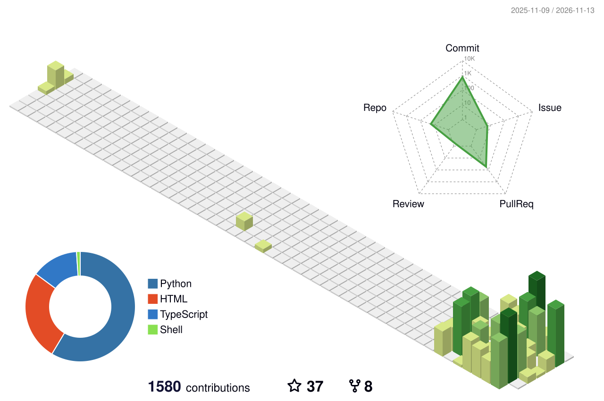

# Hey, I'm Omar 👋

I work on the part of ML that comes after training: serving models fast, turning them into agents, and checking that they actually work. At Trendyol I ran model serving for 100M+ users with Triton and vLLM. On my own, I build AI agents with Google ADK and take them all the way to production.

Google Developer Expert, Cloud AI · GDG Istanbul co-organizer · Istanbul

 
Plus NVIDIA Triton · vLLM · Google ADK

## 🔨 Things I've built

- [**sdlc-agent-pipeline**](https://github.com/omarcevi/sdlc-agent-pipeline): agents that turn a GitHub issue into a tested pull request
- [**augury**](https://github.com/omarcevi/augury): a terminal reader that ranks new AI papers and posts for you
- [**tensorhane**](https://tensorhane.com): a Turkish ML course with interactive demos
- [**claudemods**](https://github.com/omarcevi/claudemods): a community directory of Claude Code mods, plugins and skills ([claudemods.chat](https://claudemods.chat))

## 🧪 Things I measured

- A single agent matched a planner + coder + reviewer team on 15 coding tasks (36 vs 34 of 45 runs solved) and cost less per run. [sdlc-agent-pipeline](https://github.com/omarcevi/sdlc-agent-pipeline)
- At the same average rate, bursty traffic made vLLM's time to first token about 5× worse than steady traffic. [vllm-metal-bench](https://github.com/omarcevi/vllm-metal-bench)
- Splitting H100s between models with MIG gave about 1.75× more serving capacity. [One H100, Many Models](https://omarcevi.medium.com/one-h100-many-models-what-i-learned-sharing-gpus-on-kubernetes-9eb635db2311)

## 🎤 Speaking

<!-- SPEAKING:START -->
**Next:** [Retrieval Is All You Need (Almost)](https://gdg.community.dev/events/details/google-gdg-izmir-presents-devfest-izmir-2026/cohost-gdg-cloud-izmir) · DevFest İzmir 2026 · 5 December 2026

- [Building Trabzonspor's AI Analysis Room](https://omarcevi.dev/workshops/match-day-agents/) · DevFest Trabzon 2026 · workshop
- [Deploying your agents on Google Cloud Agent Platform](https://omarcevi.dev/workshops/cloud-agents-workshop/) · Google Cloud Day Türkiye – Builder Connect · workshop
- [Deploy your first AI agent to Google Cloud](https://omarcevi.dev/workshops/devfest-samsun-agent/) · DevFest Samsun 2026 · workshop

[All talks and workshops →](https://omarcevi.dev/#speaking)
<!-- SPEAKING:END -->

## ✍️ Writing

<!-- WRITING:START -->
- [One Framework to Deploy Them All! Meet NVIDIA Triton Inference Server](https://levelup.gitconnected.com/your-model-works-in-a-notebook-now-what-a-friendly-intro-to-nvidia-triton-inference-server-6a3887b0dd2b) · Oct 2026
- [One H100, Many Models: What I Learned Sharing GPUs on Kubernetes](https://omarcevi.medium.com/one-h100-many-models-what-i-learned-sharing-gpus-on-kubernetes-9eb635db2311) · Sep 2026
- [I Stopped Chasing the GDE Title. That’s When I Got It.](https://omarcevi.medium.com/i-stopped-chasing-the-gde-title-thats-when-i-got-it-eb385130109e) · Sep 2026
<!-- WRITING:END -->

## 🤝 Open source

<!-- OPEN_SOURCE:START -->
- **google/adk-web** · [Add light and dark theme toggle support to ADK Web UI](https://github.com/google/adk-web/pull/272)
- **google/adk-python** · [Fix parameter filtering for CrewAI tools that take \*\*kwargs](https://github.com/google/adk-python/pull/3037)
<!-- OPEN_SOURCE:END -->

<picture>
  <source media="(prefers-color-scheme: dark)" srcset="profile-3d-contrib/profile-night-green.svg">
  
</picture>

[omarcevi.dev](https://omarcevi.dev) · [LinkedIn](https://www.linkedin.com/in/omarcevi) · [Medium](https://omarcevi.medium.com) · [hello@omarcevi.dev](mailto:hello@omarcevi.dev)

<!-- The Speaking, Writing and Open source sections and the 3D graph update themselves every day
     (.github/workflows/update-profile.yml). Edit anything outside the START/END markers freely. -->
